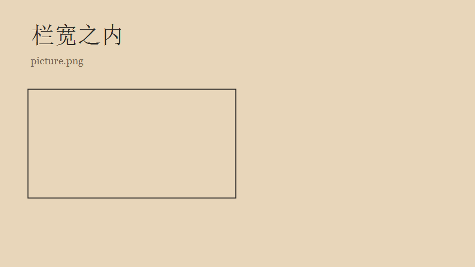

# 岗位手册里的长标题用来检查目录会不会把一整行都撑开

这是一段正文。Chinese 和 English 以及数字 2026 混在一起，带圈的步骤是 ① 准备、② 核对、③ 归档。

## 提示词

没有语言标记的围栏应该变成可以换行的文本卡片。

```
你是文档编辑。
请检查下面三件事：

① 标题是否完整
② 表格是否还能横着读
③ 空行是否还在，但不要占满一整行
```

## 一段真正的代码

```cpp
int answer = 42;
const char* name = "paper";
if (answer > 0) {
    return answer;
}
```

## 这一节下面还有小节

### 这一小节的标题故意写得很长，用来确认目录里它被收成一行，悬停能看到全文

小节正文留在这里。滚动到这一节时，目录才展开小节。

## 宽表格

| 模块 | 说明 | 状态 | 负责人 | 备注 |
| --- | --- | --- | --- | --- |
| 大纲 | 长文档靠目录定位当前章节 | ● | 甲 | 滚动时高亮 |
| 批注 | 选中文字后记在右栏 | ○ | 乙 | 默认不打开 |
| 代码 | 复制、换行、折叠 | ● | 丙 | 超过二十四行收起，这一格故意写长，用来把表格撑出栏宽 |

## 引用和提示

普通引用只留一条竖线。

> 界面退后，正文留下来。

> [!NOTE]
> 提示块只用深浅，不用红黄蓝绿。

> [!WARNING]
> 文件在外面被改过时，先问再刷新。

待办保持只读。

- [x] 大纲跟滚动走
- [ ] 批注记在右栏

## 图


